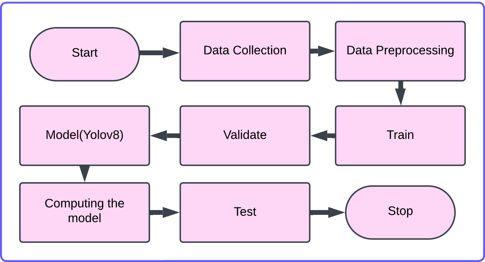
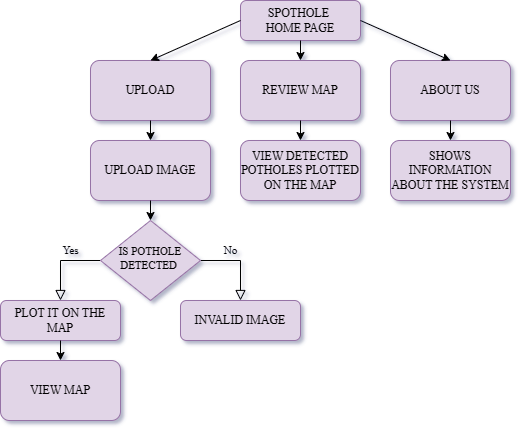
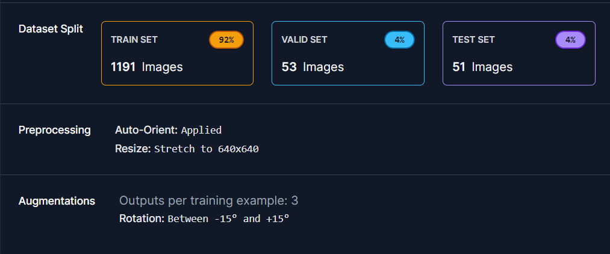
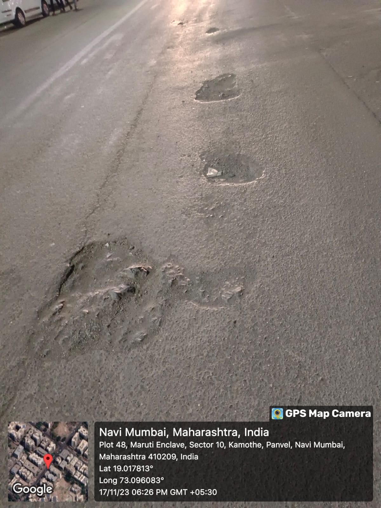
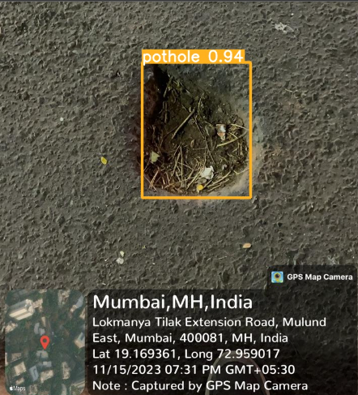
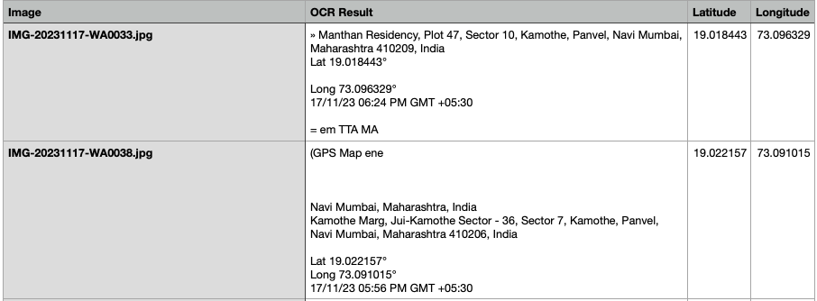
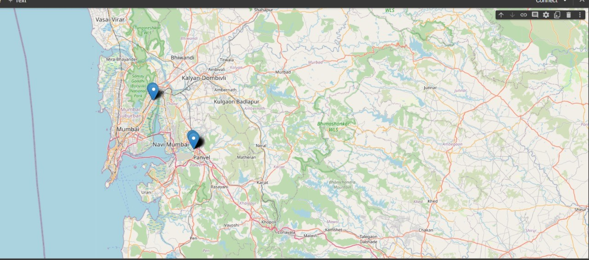
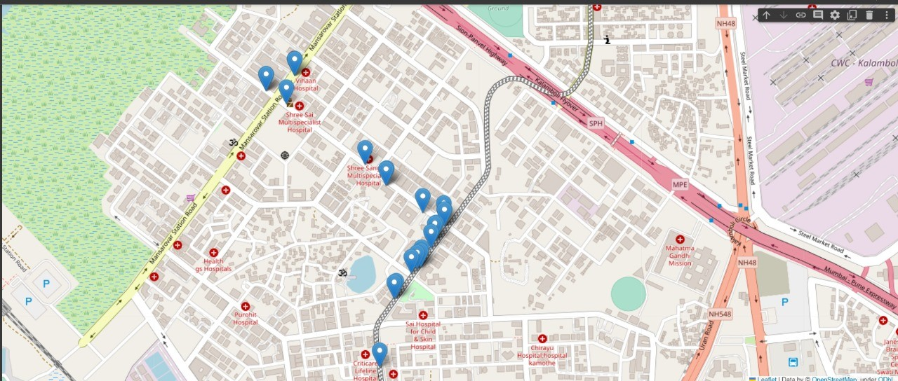

# Pothole Detection and Awareness System
 

###  Summary
The application, titled **Spothole – Pothole Detection and Awareness System**, is a deep learning–based solution developed to automatically identify and map potholes using image processing and geotagged data.  
It integrates **YOLOv8 (You Only Look Once)** for object detection and **Optical Character Recognition (OCR)** to extract GPS coordinates embedded within the image metadata.  
Detected potholes are plotted on an interactive **Folium map**, providing a clear and intuitive visualization of affected road areas. This assists both road users and municipal authorities in understanding surface conditions, prioritizing repairs, and improving urban road maintenance.

The system is implemented as a **Django web application** comprising two primary modules:  
1. **Detection Module** – Allows users to upload road images, which are processed through the YOLOv8 model to detect potholes and extract their coordinates.  
2. **Mapping Module** – Displays all detected potholes on a dynamic map interface with precise location markers.

A **comparative analysis** was performed between **YOLOv5**, **YOLOv7**, and **YOLOv8** using a consistent dataset of **1,295 images sourced from Roboflow**. These images captured a range of lighting, weather, and road conditions to ensure robustness. The evaluation metrics demonstrated the following results:  
- **YOLOv5** achieved **92% accuracy**, requiring approximately **55 epochs (~30 minutes)** for optimal performance.  
- **YOLOv7** achieved **85% accuracy** with **~21 minutes** of training.  
- **YOLOv8** achieved the **highest accuracy of 95%**, converging rapidly in just **10 epochs (~6 minutes)** and maintaining consistent detection across conditions.

Performance graphs of **precision**, **recall**, and **F1-score** indicated that YOLOv8 offered the best balance between accuracy and speed, maintaining stable results around a **confidence threshold of 0.6–0.7**.  
This efficiency and reliability made YOLOv8 the most suitable choice for deployment in the **Spothole** application.

---

###  System Design

*System Architecture*  
The architecture integrates three main modules — the YOLOv8 detection model, OCR-based coordinate extraction, and Folium mapping — all communicating through the Django backend.  
It ensures seamless processing from input image to geospatial visualization.

---

### Implementation Flow

*Implementation Workflow*  
The workflow illustrates data acquisition, preprocessing, model training, detection, and visualization phases, depicting the end-to-end operation of the pothole detection pipeline.

---

### Dataset and Model

*Description of the Dataset*  
The dataset was sourced from **Roboflow** with 1,295 images, categorized for training, validation, and testing.  
Images underwent augmentation—rotation, scaling, and lighting changes—to enhance model robustness.

*Manually Collected Dataset Samples*  
Sample images captured via geotag-enabled smartphones under varied conditions were added to strengthen detection reliability.

*Detected Pothole using YOLOv8 Model*  
YOLOv8 efficiently identifies potholes with bounding boxes and logs detections with high precision.

*Created CSV File*  
A CSV is automatically generated containing image filenames, OCR results, and corresponding GPS coordinates for mapping.

---

### Spothole Web Interface

* Home Page of Spothole Website*  
The homepage provides navigation to modules for image upload and pothole map visualization.

*Upload Pothole Image Interface*  
Users can upload an image; the system detects potholes and extracts coordinates for visualization.

*Zoomed-Out Map Showing Detected Locations*  
Displays multiple detected pothole points across geographic regions.

*Mapped Pothole Locations*  
Depicts detailed pothole positions in **Mulund** and **Kamothe, Navi Mumbai**, aiding analysis and maintenance planning.

---

### Comparative Performance

| Model  | Accuracy | Epoch | Time |
|--------|-----------|--------|------|
| YOLOv5 | 23%       | 15     | 10 mins |
| YOLOv5 | 92%       | 55     | 30 mins |
| YOLOv7 | 85%       | 10     | 21 mins |
| YOLOv8 | 95%       | 10     | 6 mins |
| YOLOv8 | 95%       | 55     | 10 mins |

This comparison confirms **YOLOv8’s** superior balance between accuracy and inference efficiency.

---

### Technologies Used
| Category | Tools / Libraries |
|-----------|-------------------|
| Deep Learning | YOLOv8 (PyTorch) |
| Image Processing | OpenCV, Roboflow |
| OCR & Geotagging | Tesseract OCR, Pillow |
| Web Framework | Django |
| Visualization | Folium (Leaflet.js) |

---

###  Conclusion
The **Pothole Detection and Awareness System** successfully integrates AI-based detection, OCR, and map visualization into a single framework.  
Through accurate pothole identification and interactive geospatial mapping, it offers a practical, automated solution for improving road safety and infrastructure maintenance.
